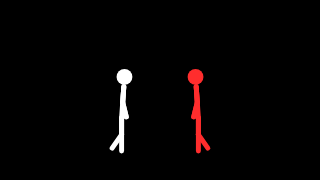

# Stickman scenes from a prompt

## Scenario

A visitor types "two friends race, one trips, the other helps him up and they dance". A
model turns that into an animspec spec: a `sequence` of clips, each with `stickman` layers
doing one beat of the story. The host validates the spec, renders it, and plays the result.
animspec has no physics and no figure reacts to another by itself, so the model
choreographs the interaction: a punch and a hit, or a trip and a reach, sit in the same clip.



## Example prompt

```text
Build a "stickman scene writer" with animspec.

1. server.js (Node 22+, ESM): POST /scene { prompt } calls my LLM (the call
   is mine, not animspec's) with:
   - the vocabulary from animspec, generated, not hand-written:
       import { selectDetailed, buildVocabPrompt, buildJsonSchema } from "animspec";
       const subset = selectDetailed("minimal", 0.4, 3, ["stickman"]).primitives;
       const vocab = buildVocabPrompt(subset), schema = buildJsonSchema(subset);
   - this system prompt:
       "Write one animspec spec as JSON for the user's scene. Use a
        `sequence` of clips at 30 fps (each { from, to, layers }, frames
        absolute, no overlaps), 2 to 6 clips, 4 seconds or less. Each clip
        holds one beat of the story, with up to 3 `stickman` layers. Keep
        each character's x the same across clips unless they move. An
        interaction goes in one clip: the actor's action (punch, kick, reach,
        point) and the other's reaction (hit, fall, look) side by side,
        facing each other. `fall` tips over once at the start of its clip;
        use `ko` in later clips to stay down. Tell characters apart with
        colour (fg, accent, fg2) and style. Use `count` for a crowd that
        shares one action. Speech comes from the frame's label, so set
        `speech: true` only on the one figure meant to talk."
   - structured output with `schema`.
2. Validate the model's JSON with validateAnimSpec. If result.dropped or
   result.errors is not empty, return them to the page and ask the model to
   fix the spec once. Then render frames 0..lastClip.to at 640x360, seed 3,
   creative: true, with a quiet synthetic signal (amplitude 0.3), and encode
   a GIF or MP4.
3. index.html: a text box, a Render button, the video, and the spec JSON with
   any dropped layers or errors shown beside it.

Hard rules:
- animspec runs in Node.js 22+ only (never import it in the browser).
- Always validate model/spectator input with validateAnimSpec before drawing,
  and surface result.dropped to the user.
- Deterministic: the same spec + signal + seed must give identical frames.
  Seed all randomness from the seed; never use Math.random or Date.
- Draw with the palette only (palette.bg / palette.fg / palette.accent).
- The host owns: canvas creation, audio → SignalFrame, file writing, playback.
```

A clip the model might write for "one punches, the other gets hit":

```json
{ "from": 24, "to": 44, "layers": [
  { "type": "stickman", "action": "punch", "x": 0.42, "facing": "right", "style": "bold" },
  { "type": "stickman", "action": "hit", "x": 0.58, "facing": "left", "style": "bold", "colour": "accent" }
] }
```

## What it yields

- `server.js`: the prompt to spec to validate to render pipeline, with one repair round.
- `index.html`: the prompt box, the rendered scene, and the validated spec with its report.

## What to check

- The model's spec went through `validateAnimSpec`. Unknown params or bad clips show up in
  `dropped`/`errors` on the page and are never silently drawn.
- Interactions line up: the actor and the reactor share a clip, face each other, and stand
  close enough to touch (an x gap of about 0.15–0.2 at `scale` 0.5).
- A `fall` is followed by `ko` in the next clip, not another `fall`, which would replay the
  tumble.
- The same prompt output, rendered twice with the same seed, gives identical frames.
