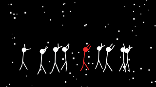

# Interactive stickman (host-driven)

## Scenario

A small interactive page: a visitor steers a stickman with the arrow keys and makes it jump,
punch or wave, while a crowd of others wanders around. It could be a game, a crowd or
evacuation simulation, or a multiplayer lobby where each player is a stick figure. The state
(positions, who is doing what) lives in the Node host. Each frame, the host turns that state
into frame data and spec patches, and animspec draws it. Nothing in animspec remembers the
previous frame.



## Example prompt

```text
Build an interactive stickman host + page with animspec.

1. server.js (Node 22+, ESM): import { createCanvas } from "@napi-rs/canvas"
   and { drawSpec, validateAnimSpec } from "animspec". Keep a game state:
   - player: { x: 0.5, y: 0.86, action: "idle", facing: "right" }
   - crowd: 8 walkers, each { x, y, vx }, moved by a seeded PRNG
     (import { mulberry32 } from "animspec"; mulberry32(seed)), never
     Math.random.
   Step the state at 30 fps from the input queue (WebSocket messages from
   the page: left/right held, jump, punch, wave). Map input to the player's
   action: left/right → "walk" with facing; nothing → "idle"; a one-shot
   key → that action for one full cycle (punch 27 frames, jump 39, wave 19
   at 30 fps), then back to idle.
   Each tick, build the spec and the SignalFrame from the state:
   spec = { background: "black", accent: "#ff2d2d", layers: [
     { type: "gridhorizon" },
     { type: "stickman", action: "walk", count: 8, from: "coords", index: 1,
       scale: 0.3, colour: "fg" },
     { type: "stickman", action: <player.action>, from: "coords", index: 0,
       facing: <player.facing>, scale: 0.42, colour: "accent", style: "bold" } ] }
   frame.coords = [ { x: player.x, y: player.y }, ...crowd.map(c => ({ x: c.x, y: c.y })) ]
   frame.index = tick, frame.t = tick / 30, frame.amplitude = 0.3
   Validate the spec when the player's action changes (not every frame),
   render 640x360 with drawSpec, and send the JPEG over the WebSocket.
2. index.html: an  for the stream, key handlers that send input
   messages, and a status line showing the player's action and any
   result.dropped from the last validation.
3. Optional: a "replay" button that re-renders the recorded input log from
   tick 0 with the same seed and shows that it matches frame for frame.

Hard rules:
- animspec runs in Node.js 22+ only (never import it in the browser).
- Always validate model/spectator input with validateAnimSpec before drawing,
  and surface result.dropped to the user.
- Deterministic: the same spec + signal + seed must give identical frames.
  Seed all randomness from the seed; never use Math.random or Date.
- Draw with the palette only (palette.bg / palette.fg / palette.accent).
- The host owns: canvas creation, audio → SignalFrame, file writing, playback.
```

Two layers here, one for the player and one for the crowd, cover any number of moving
figures up to 12 per layer. With `from: "coords"`, figure *i* of a layer stands at
`coords[index + i]`, so one coords array feeds them all. Actions are per layer: use a
separate layer when a figure needs its own action, and `count` when figures share one.

## What it yields

- `server.js`: the game state, input handling, and per-tick spec and frame building and
  rendering.
- `index.html`: the stream, keyboard input, and the status line.

## What to check

- All state is in the host. animspec gets a fresh spec and SignalFrame every tick and never
  keeps anything, so the replay of the input log matches frame for frame.
- The crowd's wandering uses a seeded PRNG, not `Math.random` or the clock.
- Coordinates passed in `frame.coords` stay within 0..1 (animspec clamps them, but the game
  should not rely on that for collisions).
- One-shot actions last one full cycle, so a punch shows a whole jab. Actions loop on the
  frame's time (`frame.t`), so a cycle can start mid-pose. That's fine for a game; for a
  scripted scene where a move must start at its first pose, put it in its own `sequence`
  clip, where time restarts at the clip's first frame.
