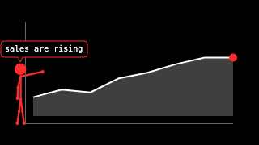

# Stickman data narrator

## Scenario

A report, dashboard or explainer video in which animspec's default avatar, the `stickman`,
presents a chart. The figure stands beside a `line-chart`, points at the newest data point,
and speaks one narration line at a time in a speech bubble. The data and the words both come
from the host: a CSV, a metrics API, or lines an LLM wrote. animspec only draws them.



## Example prompt

```text
Build a "data narrator" host + page with animspec.

1. narrate.js (Node 22+, ESM): import { createCanvas } from "@napi-rs/canvas"
   and { drawSpec, validateAnimSpec } from "animspec". Read data.csv (columns:
   date, value) and narration.json (an array of { fromFrame, text }).
   Normalise the values to 0..1 and render 30 fps frames at 960x540, seed 5,
   with this spec (validate it first and print result.dropped):
   { background: "black", accent: "#ff2d2d", layers: [
     { type: "line-chart", points: 12, fill: true, reveal: 1 },
     { type: "stickman", action: "point", x: 0.08, scale: 0.5,
       targetX: 0.9, targetY: <the newest value's y>, speech: true,
       style: "joints", colour: "accent" } ] }
   Per frame, build the SignalFrame yourself:
   - coords: one { x: i / (n - 1), y: value_i } per data point. line-chart
     reads each coord's y as a value (0 bottom, 1 top), in order.
   - labels: [the narration line whose fromFrame is the latest <= frame index].
     The stickman speaks labels[0] (cut to 40 characters).
   - amplitude: a gentle 0.3, or a spoken track's envelope if you have audio.
   Aim the point at the chart's newest point: line-chart plots values
   between about y 0.15 (top, value 1) and y 0.84 (bottom, value 0) of the
   frame, its newest point at x 0.9, so targetY ≈ 0.84 - 0.69 * newestValue.
   Pass it as a spec param; pointing aims within a few degrees, so
   "about" is enough.
2. Write the frames to narrator.mp4 (ffmpeg via stdin, raw RGBA) or PNGs.
3. index.html: play the video beside the chart's source table.

Hard rules:
- animspec runs in Node.js 22+ only (never import it in the browser).
- Always validate model/spectator input with validateAnimSpec before drawing,
  and surface result.dropped to the user.
- Deterministic: the same spec + signal + seed must give identical frames.
  Seed all randomness from the seed; never use Math.random or Date.
- Draw with the palette only (palette.bg / palette.fg / palette.accent).
- The host owns: canvas creation, audio → SignalFrame, file writing, playback.
```

If an LLM writes the narration, ask it for short lines (40 characters or fewer, one idea
each) with a `fromFrame` for each. The model's call stays on the host side; animspec only
draws the text it is given.

## What it yields

- `narrate.js`: builds each SignalFrame from the data and narration, then renders.
- `narrator.mp4` (or PNG frames) and `index.html`.

## What to check

- The speech bubble changes exactly at each line's `fromFrame`, and the same inputs replay
  the same video.
- The arm aims at the chart's newest point. If the data changes, `targetY` is recomputed
  from it rather than hard-coded.
- Lines over 40 characters were split by the host, not cut mid-word by animspec.
- `validateAnimSpec` ran on the spec, and `result.dropped` is empty or reported.
